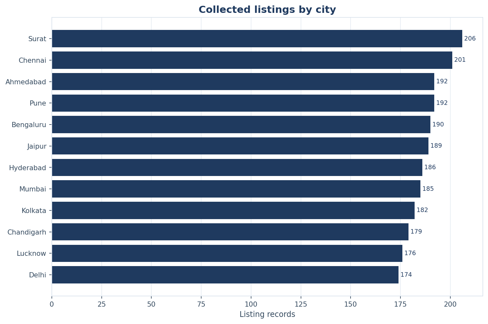
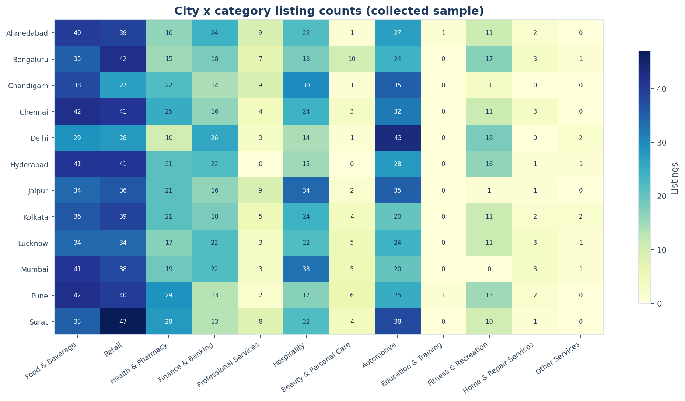
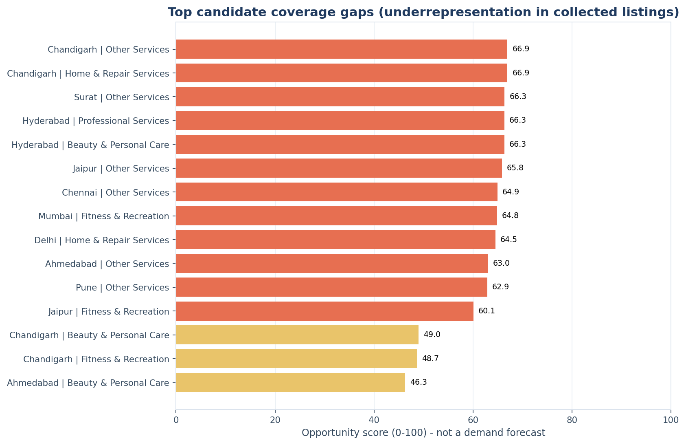

# BusinessPulse

A portfolio-ready **Data Analyst / BI** project built from a real OpenStreetMap
business-POI extract across 12 Indian cities. It covers the full workflow:
polite data collection, Python cleaning and validation, MySQL modelling, 35
analytical SQL queries, EDA, a transparent opportunity analysis, automated tests,
a database dump, and a specified four-page Power BI report.

> **Scope:** this is a **snapshot of collected public map listings**, not a
> business census, demand forecast, or investment recommendation. Contact data is
> often missing in OSM and is **not invented or enriched**. See
> [`docs/limitations.md`](docs/limitations.md).

## At a glance

| Item | Result |
|---|---|
| Snapshot | **2026-11-02** |
| Source | OpenStreetMap via Overpass API (ODbL 1.0) |
| Geography | 12 Indian cities with bounded search areas |
| Raw records | **2,252** |
| Cleaned listings | **2,252** |
| Cities / categories | **12** / **12** |
| Missing phone | **92.72%** |
| Missing address | **71.71%** |
| Strict completeness | **5.73%** (phone + address + not duplicate) |
| Exact duplicates | **3** flagged (retained for audit) |
| Analytical SQL | **35** queries, **35/35** executed |
| Coverage | **123/144** city × category pairs (**85.42%**) |
| Automated tests | **92 passed, 9 MySQL tests skipped** in the current environment (local MySQL unavailable); 99 passed in the documented 2026-11-02 run |
| Power BI | Model/PQ/DAX/design **implemented**; PBIX, Desktop validation and screenshots **pending manual action** |

Numbers above come from the generated reports in `data/reports/`; re-run the
pipeline to reproduce them. The Power BI assets are not claimed to have been
rendered here.

## Why this project exists

The interesting part is not a high completeness rate. It is building an honest,
auditable analysis when the real public data is incomplete:

- Every row keeps its OSM provenance and license.
- Missing contact data stays missing; the quality gap is measured, not hidden.
- Exact duplicates are flagged and retained, not silently deleted.
- SQL and Python recompute the opportunity score independently.
- Automated tests protect documented rules and the database contract.
- The Power BI layer is fully specified, while unverified rendering is labelled
  as pending.
- Business claims are limited to “underrepresentation in the collected sample”.

## Key findings

- **City volume is broad in this extract.** Surat has the largest sample (206, 9.15%) and Delhi the smallest (174, 7.73%); every city has at least 174 listings. This reflects the consistent collection frame and caps, not real-world city size.
- **Retail and Food & Beverage dominate.** Retail has 452 listings (20.07%) and Food & Beverage 447 (19.85%). Education & Training (2) and Other Services (8) are too thin for reliable city comparisons.
- **Contact data is the binding constraint.** 2,088 listings (92.72%) have no phone, 1,615 (71.71%) have no address, and only 129 (5.73%) meet the strict phone + address + not-duplicate rule. Missing values are flagged, not imputed.
- **Coverage is high but uneven.** 123 of 144 city x category pairs (85.42%) have at least one listing. 12 candidate cells are High tier, but 11 of those 12 have zero collected listings; they are source/sampling signals, not demand.
- **The score is a review queue, not a forecast.** The 2026-11-02 historical run recorded 35 SQL queries and 37 reconciliation checks passing, with 99 tests passing. In the current environment, 92 tests pass and 9 live MySQL tests are skipped because the local server is unavailable. The score cannot support investment or demand claims.

## Selected EDA outputs







These are **Matplotlib outputs from the Python EDA/opportunity scripts**, not
Power BI dashboard screenshots. The full generated report is
[`docs/eda_report.md`](docs/eda_report.md).

## Power BI Phase 9 status

The Power BI M, DAX, semantic-model and four-page design assets are source
controlled, but this environment could not reach the configured local MySQL
server and does not have Power BI Desktop. Consequently, no PBIX or Power BI
screenshots are claimed. See the [Phase 9 audit](reports/powerbi/final_powerbi_audit.md),
[MySQL verification report](reports/powerbi/mysql_verification_report.md),
[metric reconciliation](reports/powerbi/metric_reconciliation.csv), and
[Power BI build guide](powerbi/README.md) for verified versus pending work.

## Architecture

```text
Overpass API
  → cached JSON + collection manifest
  → raw CSV (provenance preserved)
  → Python cleaning / validation / duplicate audit / quality score
  → MySQL (8 tables, 7 views, indexes, seed data)
  → 35 analytical SQL queries → CSV exports
  → EDA tables + 9 figures + generated report
  → transparent city × category opportunity analysis
  → Power BI model/DAX/report design (manual Desktop build)
```

There is **no** FastAPI, Flask, React, Streamlit, Node service, or deployed web
application. The full stack is Python, Pandas, NumPy, MySQL, SQL, Power BI,
Power Query and DAX.

See [`docs/architecture.md`](docs/architecture.md) for layer responsibilities,
failure handling, security and the star-schema design.

## Repository map

```text
analytics/
  data_collection/   Overpass collector, cache-aware raw builder
  cleaning/          normalisation, duplicate rules, quality scoring
  validation/        blocking/warning checks and row-level evidence
  sql_analysis/      execute the 35 SQL queries and export CSVs
  eda/               EDA tables, figures and report generation
  business_insights/ opportunity score, Python recomputation, chart
  reporting/         Matplotlib theme
database/
  schema.sql         8 base tables
  views.sql          7 reporting/opportunity views
  analytical_queries.sql
  seed_data.sql, indexes.sql
  businesspulse_dump.sql   final dump (generated)
data/
  raw/               raw CSV + collection manifest (HTTP cache is gitignored)
  processed/         cleaned data, audit/reject/duplicate files
  reports/           SQL outputs, EDA, figures, insights, reconciliation
scripts/
  setup_database.py, import_data.py, verify_reconciliation.py
  run_pipeline.py, export_database_dump.py
powerbi/
  dax_measures.dax, data_model.md, power_query_guide.md
  dashboard_design.md, power_query_m/*.pq, screenshots/README.md
docs/
  data_sources.md, methodology.md, architecture.md, data_dictionary.md
  eda_report.md, business_insights.md, testing.md, limitations.md, demo_script.md
tests/
```

## Quick start

### 1. Prerequisites

- Python 3.11+ (built with Python 3.14.4).
- MySQL 8.0+ (built with MySQL 9.1).
- Power BI Desktop is **optional** for the Python/SQL deliverables and required
  only for the manual PBIX/screenshot step.

### 2. Install

```powershell
python -m venv .venv
.\.venv\Scripts\Activate.ps1
pip install -r requirements.txt
Copy-Item .env.example .env
# Edit .env with your MySQL host/port/user/password.
```

The application user should have privileges on `businesspulse` and
`businesspulse_test`. The optional admin user is only used by
`setup_database.py` to create/reset the database and user. Never commit `.env`.

### 3. Set up MySQL and import

```powershell
python scripts/setup_database.py --reset
python -m analytics.cleaning.run_cleaning
python -m analytics.validation.run_validation
python scripts/import_data.py --replace-data
```

### 4. Run the analytical layers

```powershell
python -m analytics.sql_analysis.run_queries
python -m analytics.eda.run_eda
python -m analytics.business_insights.opportunity_analysis
python scripts/verify_reconciliation.py
```

Or run the deterministic pipeline:

```powershell
python scripts/run_pipeline.py --replace-data
```

Collection is not re-run by default (it is polite and slow). Use
`--collect` only when the cache is missing or intentionally refreshing:

```powershell
python -m analytics.data_collection.collect_osm_data
python -m analytics.data_collection.build_raw_dataset
```

### 5. Tests

```powershell
python -m pytest -q                    # unit + live MySQL tests
python -m pytest -q -m "not mysql"     # offline tests only
```

### 6. Dump and Power BI

```powershell
python scripts/export_database_dump.py
```

Then follow [`powerbi/README.md`](powerbi/README.md) to build the four-page
report. Power BI Desktop was not available in the build environment, so a
`.pbix` and screenshots are intentionally absent.

## Power BI pages

1. **Executive Overview** — volume, city/category mix, quality bands.
2. **Geographic Coverage** — map, city ranking, city × category heat map.
3. **Data Quality & Completeness** — missing contact fields, quality bands,
   review queue.
4. **Market Opportunity** — methodology banner, top gaps, score decomposition,
   candidate detail.

The report uses a star schema (`FactListings`, `FactDataQuality`,
`FactCityCategoryCoverage`, `DimCity`, `DimCategory`, `DimSource`). The
opportunity score is always interpreted as a descriptive prioritisation, never
as demand. See [`powerbi/dashboard_design.md`](powerbi/dashboard_design.md).

## Verification status

| Status | Items |
|---|---|
| **VERIFIED** | Real OSM collection; cleaning and validation outputs; MySQL schema/import; 35 SQL queries; EDA; opportunity scoring; SQL/Python reconciliation; unit + live integration tests; dump restore check |
| **IMPLEMENTED, NOT VERIFIED** | Power Query M queries; DAX measures; semantic model design; four-page visual specification; manual Power BI checklist |
| **PENDING MANUAL ACTION** | Build `.pbix`; refresh in Power BI Desktop; test relationships/measures/visuals; capture screenshots; record manual reconciliation values |
| **NOT IMPLEMENTED** | Web/API/frontend; cloud deployment; scheduled refresh; customer/demand data; forecasting; full entity resolution |

No screenshot, `.pbix`, test result, database result, or data value in this
repository is fabricated. If a layer was not run, it is labelled as such.

## Documentation

| Document | Purpose |
|---|---|
| [`docs/data_sources.md`](docs/data_sources.md) | Source, license, city boxes, query design, provenance, collection limits |
| [`docs/methodology.md`](docs/methodology.md) | Cleaning, duplicate, quality, validation and opportunity definitions |
| [`docs/architecture.md`](docs/architecture.md) | End-to-end design and failure handling |
| [`docs/data_dictionary.md`](docs/data_dictionary.md) | Raw/cleaned/MySQL/Power BI field definitions |
| [`docs/business_insights.md`](docs/business_insights.md) | Findings with generated numbers and honest interpretation |
| [`docs/eda_report.md`](docs/eda_report.md) | Generated EDA report |
| [`docs/testing.md`](docs/testing.md) | Test strategy and actual final results |
| [`docs/limitations.md`](docs/limitations.md) | What the analysis cannot support |
| [`docs/demo_script.md`](docs/demo_script.md) | 5–7 minute walkthrough |
| [`powerbi/README.md`](powerbi/README.md) | Power BI status, build order, manual validation |

## Data ethics and license

The data is public business POIs from OpenStreetMap, licensed under ODbL 1.0.
Attribution: **© OpenStreetMap contributors**. The project does not scrape
private personal data, bypass access controls, or enrich missing fields from
other providers. A missing phone/address is reported as missing.

The collection started on the main Overpass endpoint and completed missing
groups through a public Overpass mirror after the main endpoint hit capacity.
The per-query endpoint is recorded in `data/raw/collection_manifest.json`; this
is a service-availability workaround, not a second data source.

If you reuse this project, preserve the OSM attribution and review ODbL
obligations. The analysis is educational and should not be used as the sole
basis for a commercial decision.
