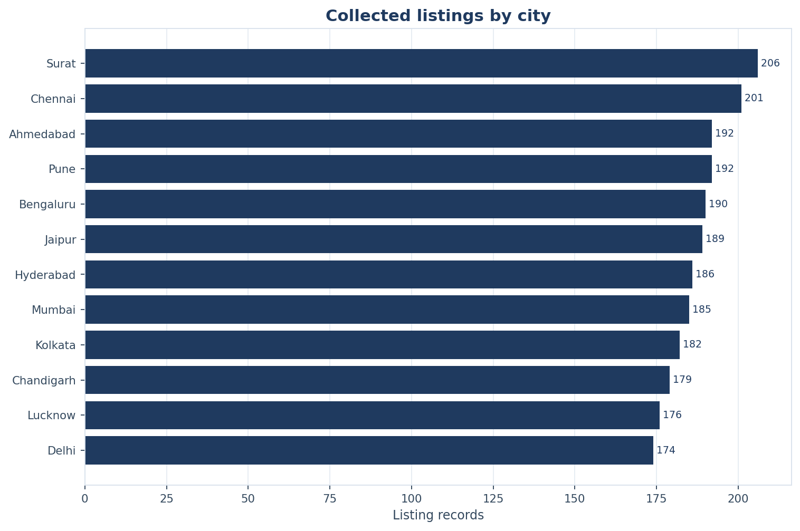
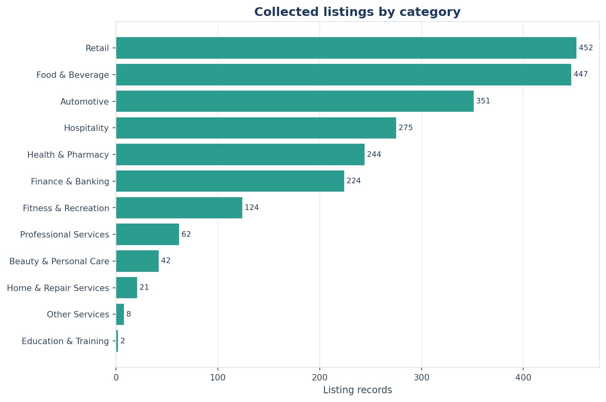
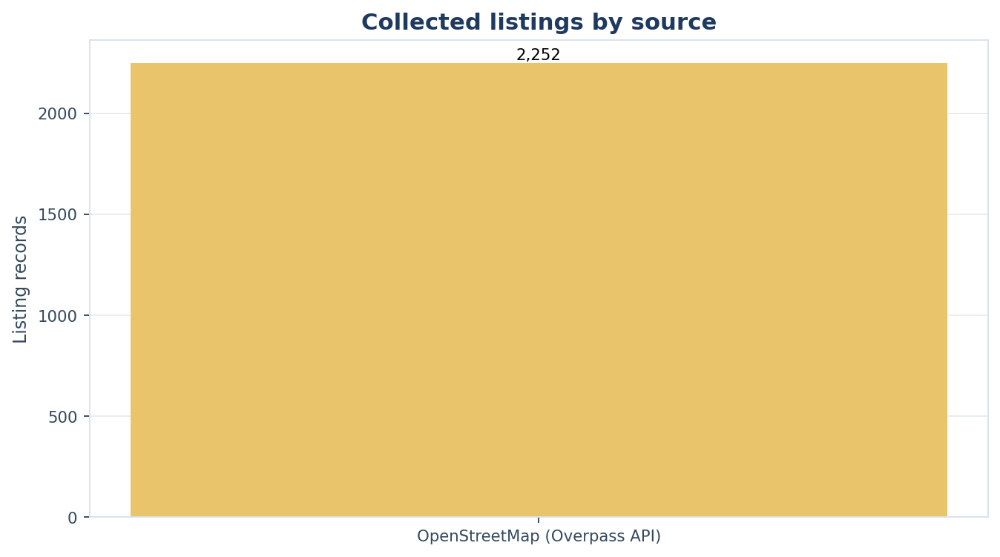
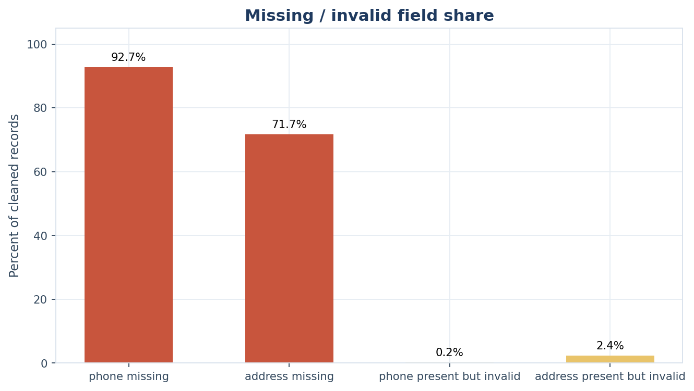
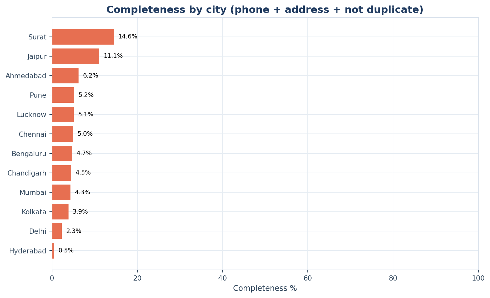
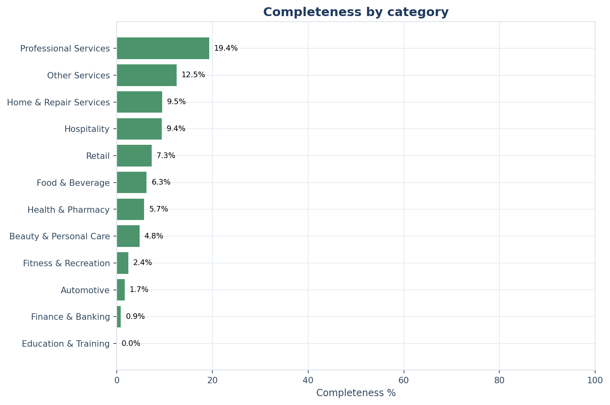
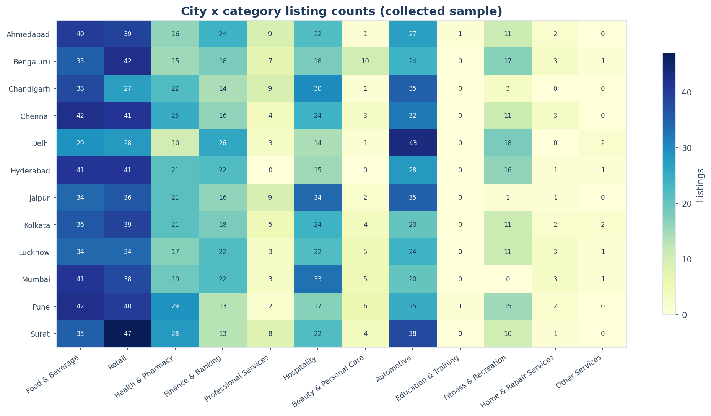
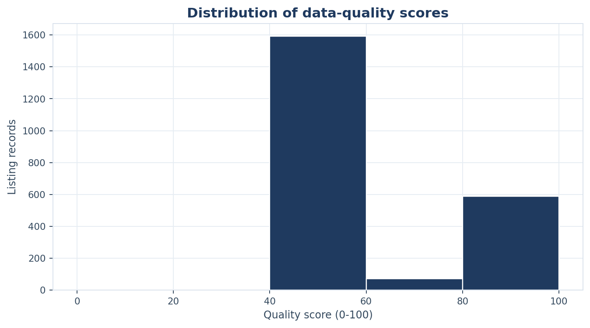
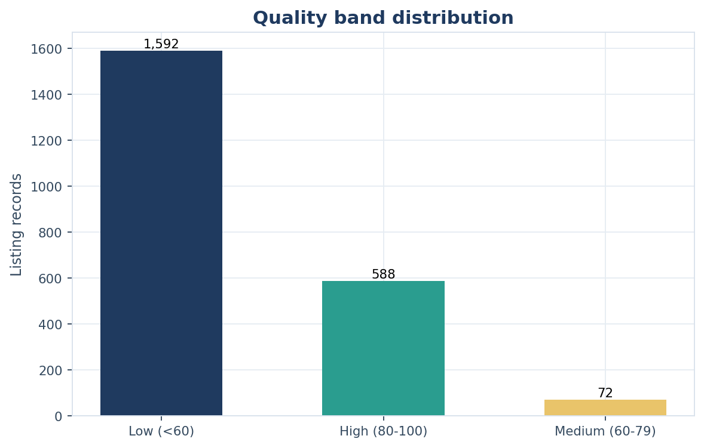

# BusinessPulse - Exploratory Data Analysis Report

## 1. Objective

Describe the collected business-listing sample, quantify its geographic and
category composition, expose data-quality limitations, and generate evidence
for the four Power BI pages.

## 2. Dataset description

- Source: **OpenStreetMap via the Overpass API** (ODbL 1.0).
- Snapshot: **2026-11-02**.
- Raw records: **2,252**; cleaned records: **2,252**.
- Cities: **12**; categories: **12**;
  sources: **1**.
- Grain: one collected business POI per row. This is a sample of public map
  listings, not a complete business census.

## 3. Cleaning and validation steps

The raw extract is preserved in `data/raw/business_listings_raw.csv`. Cleaning
normalises business names, cities, categories, addresses and phone formats;
it does not invent missing contact data. Exact duplicates are flagged and
retained for audit. Suspicious records are rejected with reasons in
`data/processed/rejected_records.csv`.

Validation checks required fields, city/category membership, source validity,
phone format, address structure, duplicate keys, dates, coordinates and audit
consistency. Blocking errors: **0**.

## 4. Key observations

- Largest city representation: **Surat**
  with **206** records
  (9.2% of the sample).
- Smallest city representation: **Delhi**
  with **174** records.
- Most common category: **Retail**
  with **452** records
  (20.1%).
- Least represented category: **Education & Training**
  with **2** records.
- Missing phone: **2,088**
  (92.72%).
- Missing address: **1,615**
  (71.71%).
- Duplicate rate: **0.13%**.
- Completeness (phone + address + not duplicate): **5.73%**.
- Covered city-category pairs: **123** of
  **144** possible
  (85.4%).

## 5. City distribution

| city | state_name | listing_count | share_pct | categories_present | completeness_pct | avg_quality_score |
|---|---|---|---|---|---|---|
| Surat | Gujarat | 206 | 9.15 | 10 | 14.56 | 73.45 |
| Chennai | Tamil Nadu | 201 | 8.93 | 10 | 4.98 | 59.33 |
| Ahmedabad | Gujarat | 192 | 8.53 | 11 | 6.25 | 65.42 |
| Pune | Maharashtra | 192 | 8.53 | 11 | 5.21 | 63.10 |
| Bengaluru | Karnataka | 190 | 8.44 | 11 | 4.74 | 65.61 |
| Jaipur | Rajasthan | 189 | 8.39 | 10 | 11.11 | 65.11 |
| Hyderabad | Telangana | 186 | 8.26 | 9 | 0.54 | 57.77 |
| Mumbai | Maharashtra | 185 | 8.21 | 10 | 4.32 | 63.86 |
| Kolkata | West Bengal | 182 | 8.08 | 11 | 3.85 | 63.38 |
| Chandigarh | Chandigarh | 179 | 7.95 | 9 | 4.47 | 60.95 |
| Lucknow | Uttar Pradesh | 176 | 7.82 | 11 | 5.11 | 63.38 |
| Delhi | Delhi | 174 | 7.73 | 10 | 2.30 | 57.61 |

## 6. Category distribution

| category | listing_count | share_pct | cities_present | completeness_pct | avg_quality_score |
|---|---|---|---|---|---|
| Retail | 452 | 20.07 | 12 | 7.30 | 64.78 |
| Food & Beverage | 447 | 19.85 | 12 | 6.26 | 63.30 |
| Automotive | 351 | 15.59 | 12 | 1.71 | 61.48 |
| Hospitality | 275 | 12.21 | 12 | 9.45 | 63.33 |
| Health & Pharmacy | 244 | 10.83 | 12 | 5.74 | 67.15 |
| Finance & Banking | 224 | 9.95 | 12 | 0.89 | 58.93 |
| Fitness & Recreation | 124 | 5.51 | 11 | 2.42 | 59.76 |
| Professional Services | 62 | 2.75 | 11 | 19.35 | 71.05 |
| Beauty & Personal Care | 42 | 1.87 | 11 | 4.76 | 63.69 |
| Home & Repair Services | 21 | 0.93 | 10 | 9.52 | 67.62 |
| Other Services | 8 | 0.36 | 6 | 12.50 | 63.75 |
| Education & Training | 2 | 0.09 | 2 | 0.00 | 55.00 |

## 7. Source distribution

| source | source_type | listing_count | share_pct | missing_phone_pct | missing_address_pct | completeness_pct |
|---|---|---|---|---|---|---|
| OpenStreetMap (Overpass API) | Open Data - Crowdsourced Map | 2252 | 100.00 | 92.72 | 71.71 | 5.73 |

The dataset contains one source. Source comparisons are therefore descriptive,
not comparative; see `docs/limitations.md`.

## 8. Findings and interpretation

1. **City coverage is broad in this extract.** The largest city contributes
   9.2% of records;
   the smallest contributes
   7.7%. The
   even spread reflects the consistent collection frame and caps, not relative
   market size.
2. **Contact data is the binding constraint.** Phone is missing for
   92.7% and address for
   71.7% of records. This limits the
   reliability of any contactability conclusion and explains the low
   completeness rate.
3. **Category mix is uneven.** The largest category is
   **Retail** with
   **452**
   records (20.1%).
   A few consumer-facing categories dominate the visible sample; specialist
   categories are thinner. This reflects public mapping visibility, not market
   size.
4. **City-category gaps are candidates for research only.** Zero or low counts
   in a city-category cell indicate underrepresentation in this collected
   sample. They do not establish low competition or unmet demand.

## 9. Figures

## 10. Limitations

- OpenStreetMap is crowd-sourced and unevenly maintained; a missing field is
  not evidence that a business lacks a phone or address.
- The snapshot contains one collection date, so time-trend analysis is not
  meaningful.
- One source prevents source-adjusted comparisons.
- Bounding boxes may include neighbouring urban areas.
- Category mapping is rule-based and may merge distinct business models.
